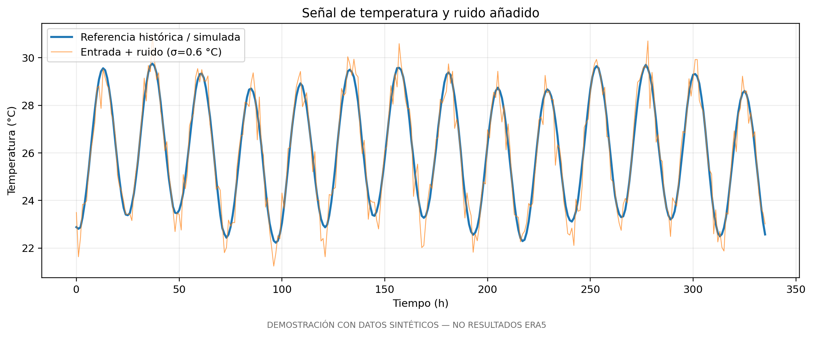
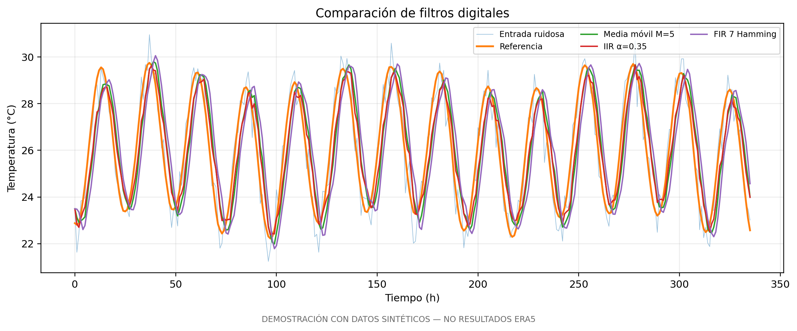
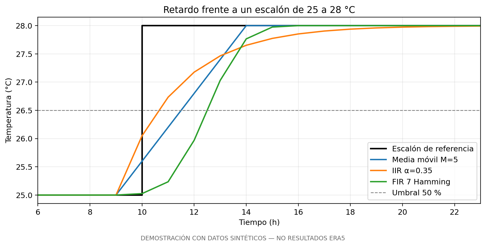
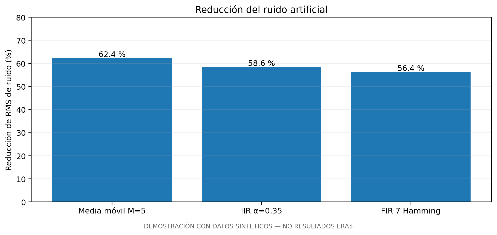

# TDS115 — Proyecto 9: Comparador de suavizado para sensores

## Descripción
Proyecto final de Tratamiento Digital de Señales (TDS115). Comparación reproducible de filtros **media móvil, IIR de primer orden y FIR con ventana Hamming** sobre una serie histórica real de temperatura de San Salvador, El Salvador.

**Estado del repositorio:** Fase 1 — propuesta (los resultados y el código de las siguientes fases están pendientes).

## Objetivo
Diseñar y comparar en Python tres métodos de suavizado sobre una serie histórica real de 336 valores 
horarios de temperatura de San Salvador, cuantificando la reducción del ruido añadido y el retardo de 
cada filtro mediante dos mediciones verificables

## Datos y procedencia
- Fuente: Open-Meteo, Historical Weather API: https://open-meteo.com/en/docs/historical-weather-api
- Variable: `temperature_2m` (temperatura del aire a 2 m, °C)
- Ubicación aproximada: San Salvador (13.6929, -89.2182)
- Período: 2026-10-01 al 2026-10-14, ambos inclusive (336 horas)
- Datos meteorológicos históricos de modelos/reanálisis; **no equivalen a lecturas directas del sensor**.
- Endpoint de consulta propuesto:

```text
https://archive-api.open-meteo.com/v1/archive?latitude=13.6929&longitude=-89.2182&start_date=2026-10-01&end_date=2026-10-14&hourly=temperature_2m&timezone=America%2FEl_Salvador&models=era5
```

## Parámetros preliminares
| Parámetro | Valor |
| --- | --- |
| Intervalo de muestras | 1 h |
| Frecuencia de muestreo | 1/3600 Hz |
| Representación virtual | 12 bits en 0–50 °C, solo simulación |
| Ruido agregado | N(0, 0.6²) °C, semilla 115 |
| Media móvil | 5 muestras |
| IIR de primer orden | alpha = 0.35 |
| FIR con ventana Hamming | 7 coeficientes, normalizados a suma 1 |

## Dos mediciones
1. **Ruido residual:** RMS de la diferencia entre las salidas con y sin ruido conocido; expresar la reducción en %.
2. **Retardo:** cruce al 50 % de un escalón conocido, en horas. Referencias previstas: 2 h (media móvil), 1 h (IIR) y 3 h (FIR).

## Archivos previstos
```text
tds115-proyecto9-suavizado/
├── README.md
├── documentos/
│   └── Fase_1_Proyecto_9_TDS115.docx
├── presentaciones/
│   └── Pitch_Fase_1_Proyecto_9_TDS115.pptx
├── datos/                 # CSV real (fase 2)
├── notebooks/             # Colab de diseño y validación (fases 2 y 3)
└── resultados/            # Tablas y gráficas (fase 3)
```

## Cronograma
- Semana 1: propuesta, fuente de datos, pitch de 3 minutos, README y repositorio.
- Semana 2: teoría, bibliografía IEEE, primer código funcional y gráficos.
- Semana 3: datos reales, dos validaciones, artículo IMRDB y defensa.

## Integrantes
- [RUENDY JOSUÉ GRANADOS LÓPEZ				 GL19016 ]
- [CARLOS ALEJANDRO JIMÉNEZ MARTÍNEZ 	     JM21009 ]
- [HERBERT ENRIQUE GOMEZ NUÑEZ 				 GN21001 ]

**Trabajo compartido:** los tres integrantes intervienen en diseño, código, mediciones y redacción; cualquiera debe poder explicar todo el proyecto.

## Licencia y atribución
Atribuir los datos a Open-Meteo y sus fuentes meteorológicas conforme a las condiciones de uso publicadas. Conservar la versión y fecha de descarga cuando se obtenga el archivo.
---

## FASE 2 — SIMULACIÓN Y COMPARACIÓN DE FILTROS DIGITALES

### Descripción

Se implementó en Python con SciPy un comparador de tres filtros
digitales para el suavizado de señales de temperatura:

- Media móvil de 5 muestras.
- Filtro IIR de primer orden (α = 0.35).
- Filtro FIR de 7 coeficientes con ventana Hamming.

La simulación utiliza 336 muestras de temperatura y ruido gaussiano
artificial de desviación estándar de 0.6 °C, con semilla 115.

### Código Python

[Consultar el código de la Fase 2](comparador_fase2.py)

### Gráficas de simulación

#### Figura 1. Temperatura de referencia y señal con ruido



#### Figura 2. Comparación de los filtros digitales



#### Figura 3. Respuesta al escalón y retardo de detección



#### Figura 4. Reducción porcentual del ruido



### Resultados

Los filtros se evalúan mediante dos indicadores:

1. Reducción porcentual del ruido residual mediante RMS.
2. Retardo de detección frente a un escalón de temperatura.

[Consultar resultados numéricos](resultados/resultados_comparativos.csv)

### Artículo IEEE

El artículo técnico de la Fase 2 documenta los fundamentos
matemáticos, el estado del arte, la metodología y los resultados
de la simulación.

### Observaciones

Los registros históricos de Open-Meteo corresponden a estimaciones
meteorológicas y no a mediciones directas de un sensor físico.

El ruido se incorpora artificialmente para evaluar la capacidad
de los filtros digitales.

El proyecto no constituye una calibración física de sensores.

---
